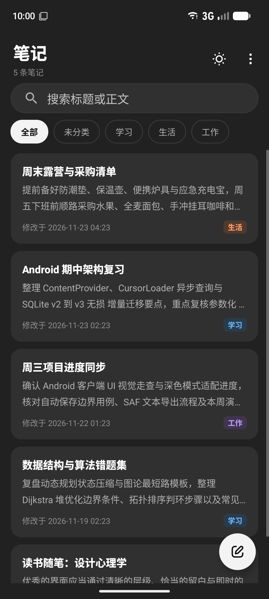
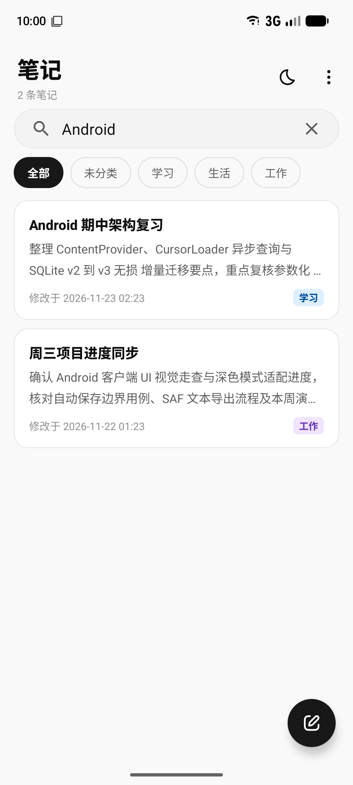
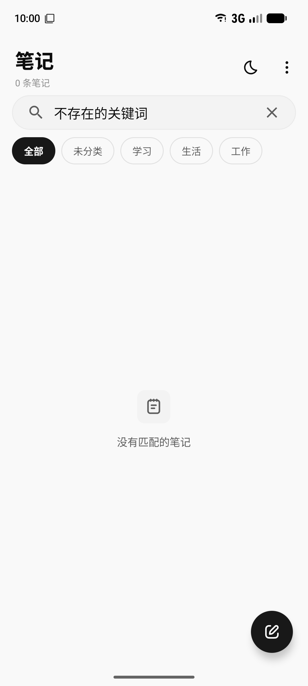
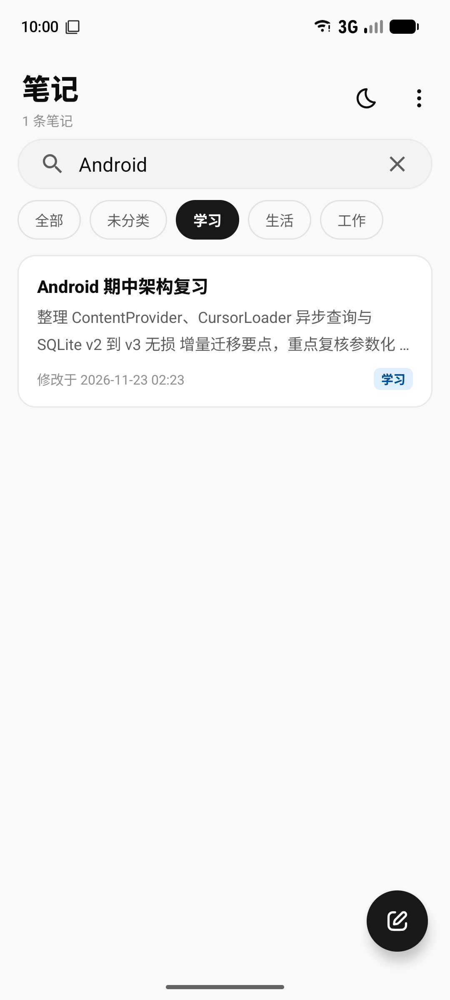
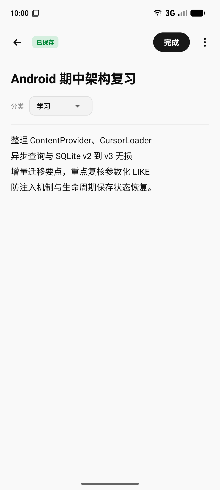
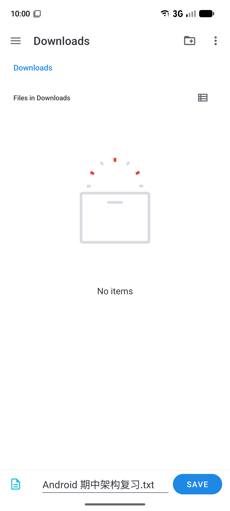
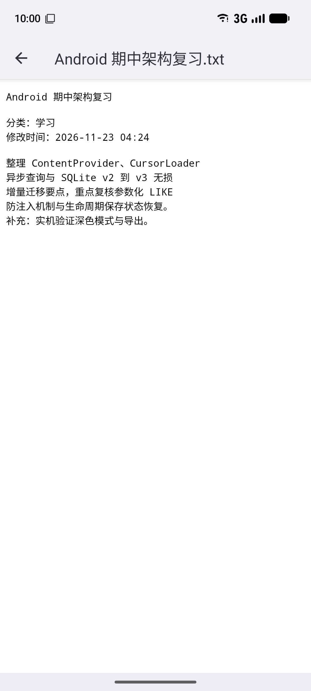
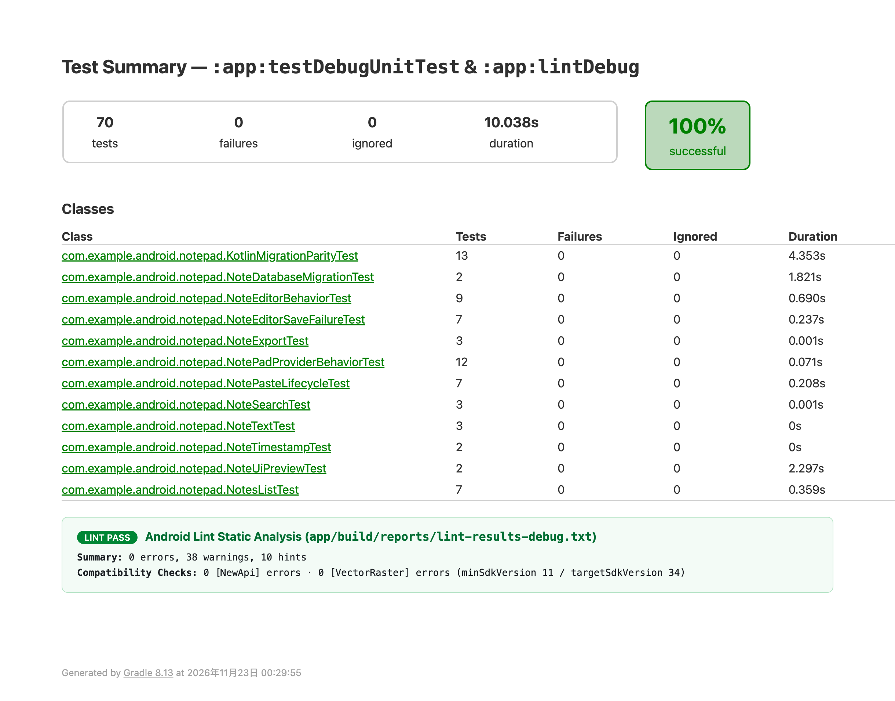
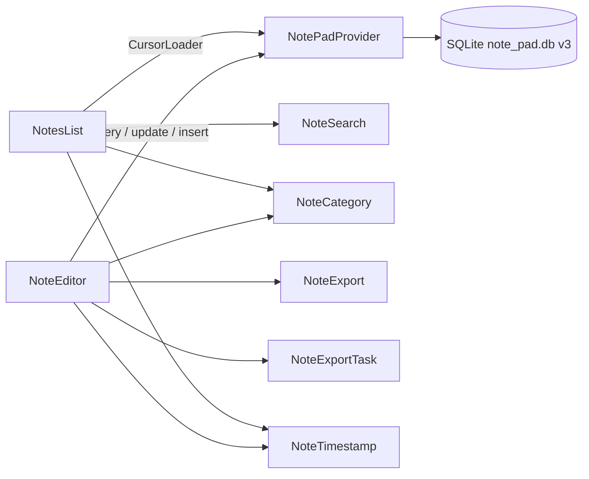

# NotePad 期中实验

基于教师指定的 [fjnu-cse/NotePad](https://github.com/fjnu-cse/NotePad) 示例扩展的本地记事本。技术栈为 **Kotlin 2.3.21 + 原生 XML Views + SQLite / ContentProvider + CursorLoader**，生产代码 0 第三方库依赖，`minSdk 11` / `targetSdk 34` / `compileSdk 35`。

<p align="center">
  
  &nbsp;&nbsp;
  
</p>

> 文中截图均在 Android Studio 模拟器（AVD `Pixel_6`，API 37 系统镜像）上由脚本 [capture_readme_shots.py](tools/device-test/capture_readme_shots.py) 实拍，状态栏固定为 10:00。其中第 13 张为 Gradle 与 Lint 的真实报告渲染。

## 一、评分细则对照索引

| 评分项 | 分值 | 实现要点 | 章节 | 截图 |
| --- | :---: | --- | --- | --- |
| 基本功能 1：列表时间戳与智能更新 | 5 | 列表显示最近修改时间并按时间倒序；仅标题、正文、分类真正变化时才刷新修改时间 | [2.1](#21-笔记列表时间戳与智能更新5-分) | 01, 02 |
| 基本功能 2：标题与正文实时搜索 | 5 | `SearchView` 输入即查，参数化 `LIKE ... ESCAPE`，标题或正文命中，含搜索空态 | [2.2](#22-标题与正文参数化实时搜索5-分) | 03, 04 |
| 核心扩展 1：分类管理与组合筛选 | 4 | 4 个分类、分类标签筛选与关键词叠加；数据库 v2→v3 增量升级 | [3.1](#31-核心扩展-1笔记分类管理与搜索组合筛选) | 05, 06 |
| 核心扩展 2：UI 现代化与深色模式 | 4 | 参考 `openai/apps-sdk-ui` 的浅/深双色体系、语义徽章、一键切换深浅色 | [3.2](#32-核心扩展-2全局-ui-现代化与完整深色模式) | 07, 08, 09, 12 |
| 加分 1：UTF-8 文本导出 | — | SAF `ACTION_CREATE_DOCUMENT`，后台写入，旋转后状态保留 | [3.3](#33-加分项-1单篇笔记-utf-8-文本导出) | 09, 10, 11 |
| 加分 2：自动保存与现代 Android 适配 | — | 保存失败拦截与草稿恢复、预测性返回、剪贴板焦点门控 | [3.4](#34-加分项-2高可靠自动保存异常恢复与现代-android-适配) | 12 |
| 加分 3：工程质量 | — | 12 个模块、70 项单元测试、Lint 0 Error、Java→Kotlin 迁移 | [3.5](#35-加分项-3工程重构kotlin-迁移与自动化测试) | 13 |

## 二、基本功能

### 2.1 笔记列表时间戳与智能更新（5 分）

- 列表项显示“修改于 yyyy-MM-dd HH:mm”，由 [NoteTimestamp](app/src/main/java/com/example/android/notepad/NoteTimestamp.kt) 按设备时区与语言格式化；时间缺失或非法时显示“时间未知”。
- 排序为 `modified DESC`，同一时间再按 `_id DESC`（见 [NotesList.kt](app/src/main/java/com/example/android/notepad/NotesList.kt) 中的 `NotesLoader`）。
- “智能更新”由 [NotePadProvider.update](app/src/main/java/com/example/android/notepad/NotePadProvider.kt) 保证：编辑页写入不携带 `modified`，Provider 自动追加“该行标题、正文或分类确有不同”的条件，满足时才写入当前时间，打开后不改动直接返回不会改变时间。

```kotlin
// 只有可编辑列真的不同，才会命中该行并刷新 modified
differences.add("$column IS NOT ?")
...
updatedValues.put(NotePad.Notes.COLUMN_NAME_MODIFICATION_DATE, System.currentTimeMillis())
```

| 初始列表（时间梯度） | 编辑“周末露营与采购清单”并保存后 |
| :---: | :---: |
|  |  |

右图中被编辑的笔记置顶且时间刷新；中途打开又直接返回的“周三项目进度同步”，以及其余笔记的时间均与左图相同。

### 2.2 标题与正文参数化实时搜索（5 分）

- 搜索框每次文本变化都会重启 `CursorLoader`，查询在后台线程执行。
- [NoteSearch](app/src/main/java/com/example/android/notepad/NoteSearch.kt) 以 `(title LIKE ? ESCAPE '!' OR note LIKE ? ESCAPE '!')` 匹配，关键词以绑定参数传入，并转义 `!`、`%`、`_`，因此输入特殊字符不会被当作通配符或拼接进 SQL。
- 无结果时复用 `@android:id/empty` 显示空态图标与“没有匹配的笔记”，顶部计数同步更新。

| 搜索 “Android”：标题命中 + 正文命中 | 搜索不存在的关键词 |
| :---: | :---: |
|  |  |

左图两条结果：一条为标题含 Android，另一条仅正文含 Android。

## 三、扩展功能

### 3.1 核心扩展 1：笔记分类管理与搜索组合筛选

- 分类为 `uncategorized / study / life / work`（未分类 / 学习 / 生活 / 工作），数据库存稳定 ID，界面再翻译成标签（[NoteCategory](app/src/main/java/com/example/android/notepad/NoteCategory.kt)）。Provider 在写入时校验分类 ID。
- 列表顶部为分类筛选胶囊，与关键词叠加：`(title LIKE ? OR note LIKE ?) AND category = ?`。新建笔记时默认使用当前筛选的分类。
- 编辑页用胶囊样式的 `Spinner` 修改分类。
- 数据库版本为 3：`DatabaseHelper.onUpgrade` 对已知的 v2→v3 执行 `ALTER TABLE notes ADD COLUMN category TEXT NOT NULL DEFAULT 'uncategorized'`，旧笔记原样保留；未知版本抛出异常而不是清库。该升级由 `NoteDatabaseMigrationTest` 覆盖。

| 学习分类 + 关键词 “Android” | 统一编辑页（分类下拉） |
| :---: | :---: |
|  |  |

### 3.2 核心扩展 2：全局 UI 现代化与完整深色模式

设计参考 OpenAI 开源的 [`openai/apps-sdk-ui`](https://github.com/openai/apps-sdk-ui)（MIT License）的色彩与组件规范，用原生 XML 与矢量资源落地。

| 令牌 | 浅色 | 深色 |
| --- | --- | --- |
| 页面背景 `page` | `#F9F9F9` | `#212121` |
| 卡片 `card_surface` | `#FFFFFF`，8% 黑色发丝边 | `#303030`，无描边 |
| 主文字 `ink` | `#0D0D0D` | `#FFFFFF` |
| 次要文字 `muted` / 辅助 `tertiary` | `#5D5D5D` / `#8F8F8F` | `#AFAFAF` / `#8F8F8F` |
| 主按钮 `accent` | `#181818` | `#F3F3F3` |

- **语义徽章**：分类（学习蓝、工作紫、生活橘、未分类灰）与编辑页保存状态（已保存绿、编辑中橘、失败红、中性灰）统一为 6dp 圆角 + 半透明底色。
- **深浅色适配**：`values` / `values-night` 提供两套颜色；`values-v21`、`values-v23`、`values-v27` 与 `values-night-v21` 分别处理状态栏、导航栏的图标明暗以及原生 `AlertDialog`、`PopupMenu`、`Spinner` 的深色主题，`TitleEditor` 也使用 `AppDialogTheme`。
- **一键切换**：列表顶栏的月亮/太阳按钮（`R.id.theme_toggle`）在 API 31+ 通过 `UiModeManager.setApplicationNightMode` 切换；更低版本自动隐藏并跟随系统。该调用被隔离在 `@TargetApi(31)` 的 `NightModeToggle` 内，保证 `minSdk 11` 不触发 `NewApi`。
- **中文字重**：标题、徽章与按钮样式显式设置 `textStyle="bold"`，避免 CJK 字体在 `sans-serif-medium` 下退化为常规字重。
- **图标**：从 `apps-sdk-ui` 移植 6 个矢量图标（`ComposeEditSquare`、`DarkMode`、`LightMode`、`ArrowLeft`、`DotsVertical`、`Notepad`），保留 MIT 版权注释头。

| 深色列表（顶栏为太阳图标） | 深色编辑页 |
| :---: | :---: |
|  |  |

| 深色编辑页溢出菜单 | 深色删除确认对话框 |
| :---: | :---: |
|  |  |

### 3.3 加分项 1：单篇笔记 UTF-8 文本导出

- 编辑页菜单“导出为文本”先保存当前内容，再通过 `Intent.ACTION_CREATE_DOCUMENT`（`text/plain`）拉起系统保存界面，文件名由 [NoteExport.filename](app/src/main/java/com/example/android/notepad/NoteExport.kt) 清洗非法字符并限制长度。
- 写入由 [NoteExportTask](app/src/main/java/com/example/android/notepad/NoteExportTask.kt) 在后台完成，只持有 `WeakReference<NoteEditor>`，并借助 `onRetainNonConfigurationInstance` 在屏幕旋转后继续交付结果。写入或关闭流失败会明确提示。
- 导出文件格式为：标题、空行、`分类：…`、`修改时间：…`、空行、正文，编码 UTF-8。导出不会改动笔记的任何字段与时间。

| 菜单入口 | 系统保存界面（预填文件名） | 导出的 `.txt` 内容 |
| :---: | :---: | :---: |
|  |  |  |

### 3.4 加分项 2：高可靠自动保存、异常恢复与现代 Android 适配

- **自动保存**：离开编辑页（返回键、`onPause`、`onSaveInstanceState`）都会保存实际有变化的内容；空白新草稿会被清理而不留下空笔记。保存前先确认笔记仍存在。
- **保存失败**：失败时留在编辑页，状态徽章变红，输入保留；旋转或进程重建后可从草稿恢复，菜单提供“另存为新笔记”。
- **预测性返回**：API 33+ 通过 `@TargetApi(33)` 的 `BackNavigation` 注册 `OnBackInvokedCallback`，与旧版 `onBackPressed` 行为一致。
- **剪贴板**：Android 10+ 只有获得窗口焦点的应用才能读剪贴板，粘贴动作在 `onWindowFocusChanged` 中一次性消费；粘贴自身 URI 或已被删除的来源会得到明确提示。
- **低版本兼容**：`Cursor` 在 API 16 才实现 `Closeable`，工程使用自定义 `useCompat` 保持 `minSdk 11` 可用。

### 3.5 加分项 3：工程重构、Kotlin 迁移与自动化测试

- 代码拆分为 12 个高内聚模块（见下节），全部迁移为 Kotlin，并有字节码层面的核验记录（见 [docs/kotlin-migration-harness](docs/kotlin-migration-harness)）。
- 单元测试共 12 个测试类、70 项（JUnit 4.13.2 + Robolectric 4.14.1），覆盖 Provider 读写、数据库升级、搜索与时间戳、编辑页保存与失败恢复、粘贴生命周期、导出，以及浅/深色 UI 离线渲染。
- 最近一次执行：70 项全部通过；Lint 为 0 Error、38 Warning、10 Hint，`[NewApi]` 与 `[VectorRaster]` 均为 0。

<p align="center"></p>

## 四、技术架构与设计边界

| 模块 | 职责 |
| --- | --- |
| [NotePad](app/src/main/java/com/example/android/notepad/NotePad.kt) | Provider 契约：authority、URI、列名、排序 |
| [NotePadProvider](app/src/main/java/com/example/android/notepad/NotePadProvider.kt) | `ContentProvider`，SQLite 建库与升级，按变化更新时间 |
| [NotesList](app/src/main/java/com/example/android/notepad/NotesList.kt) | 列表、搜索、分类筛选、主题切换、`CursorLoader` |
| [NoteEditor](app/src/main/java/com/example/android/notepad/NoteEditor.kt) | 编辑、自动保存、失败恢复、粘贴、导出入口 |
| [NoteCategory](app/src/main/java/com/example/android/notepad/NoteCategory.kt) | 分类 ID、标签与徽章样式映射 |
| [NoteSearch](app/src/main/java/com/example/android/notepad/NoteSearch.kt) | 参数化查询条件与转义 |
| [NoteText](app/src/main/java/com/example/android/notepad/NoteText.kt) | 标题生成、摘要截断（按码点） |
| [NoteTimestamp](app/src/main/java/com/example/android/notepad/NoteTimestamp.kt) | 时间格式化 |
| [NoteExport](app/src/main/java/com/example/android/notepad/NoteExport.kt) | 文件名清洗、导出文档格式、流写入 |
| [NoteExportTask](app/src/main/java/com/example/android/notepad/NoteExportTask.kt) | 后台导出任务与跨旋转交付 |
| [TitleEditor](app/src/main/java/com/example/android/notepad/TitleEditor.kt) | 保留的标题编辑对话框 |
| [NotesLiveFolder](app/src/main/java/com/example/android/notepad/NotesLiveFolder.kt) | 保留的示例入口 |



**设计边界**

- 数据只保存在本机应用私有数据库，不含云同步与导入恢复；导出为单篇纯文本。
- 保持 0 第三方生产依赖以维持 `minSdk 11`；应用内深浅色切换需要 API 31+，更低版本跟随系统，文本导出需要 API 19+。
- 搜索为字面子串匹配，不做分词或排序相关性。

**开源致谢与许可**

- 示例工程来自 [fjnu-cse/NotePad](https://github.com/fjnu-cse/NotePad)，原 Android Open Source Project 源码保留 Apache-2.0 版权头。
- UI 色彩与组件规范及 6 个矢量图标参考并移植自 [openai/apps-sdk-ui](https://github.com/openai/apps-sdk-ui)，MIT License，Copyright OpenAI；对应图标文件头保留了原版权注释。

## 五、构建、测试与运行

| 项目 | 版本 |
| --- | --- |
| Gradle Wrapper / AGP | 8.13 / 8.12.2 |
| Kotlin | 2.3.21 |
| JDK | OpenJDK 21 |
| SDK | compileSdk 35、targetSdk 34、minSdk 11 |

用 Android Studio 打开含 `settings.gradle` 的本目录即可同步运行。命令行（JDK 与 SDK 路径按本机替换，首次需联网拉取依赖，已缓存时可加 `--offline`）：

```bash
env JAVA_HOME=/opt/homebrew/opt/openjdk@21/libexec/openjdk.jdk/Contents/Home \
  ANDROID_HOME=$HOME/Library/Android/sdk \
  bash ./gradlew --no-daemon :app:assembleDebug :app:testDebugUnitTest :app:lintDebug --console=plain
```

| 输出 | 路径 |
| --- | --- |
| APK | `app/build/outputs/apk/debug/app-debug.apk` |
| 测试报告 | `app/build/reports/tests/testDebugUnitTest/index.html` |
| Lint 报告 | `app/build/reports/lint-results-debug.html` |
| 离线 UI 渲染图 | `app/build/outputs/ui-preview/*.png` |

**更多文档**：[文档总览](docs/README.md) · [项目说明](docs/项目说明.md) · [构建运行与演示](docs/构建运行与演示.md) · [测试与交付状态](docs/测试与交付状态.md) · [UI 美化验收交接](docs/UI美化验收与下一阶段交接文档.md)
