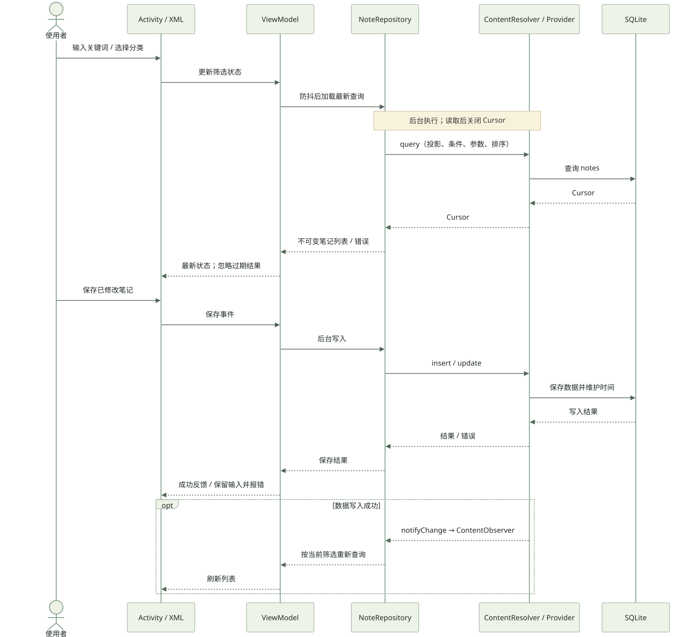
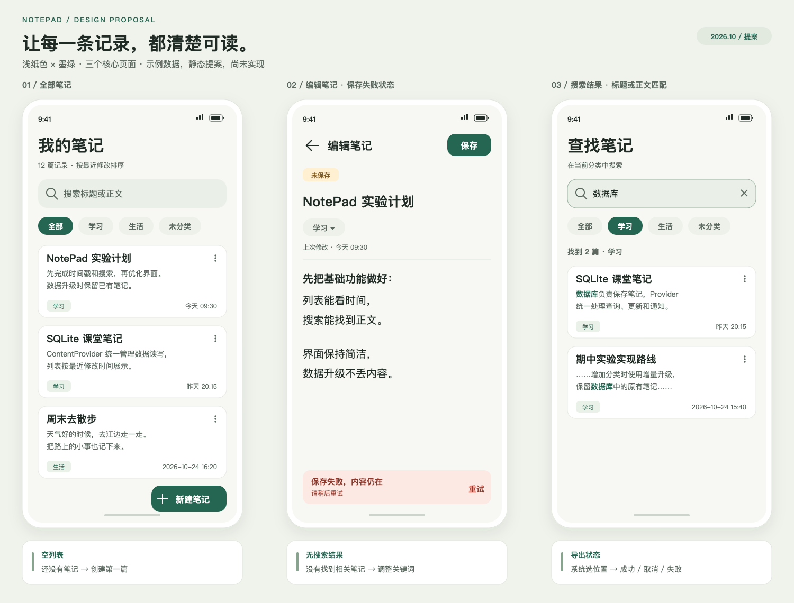

> 历史存档。保留整理前内容与当时判断，不能作为当前实现或构建指引。当前入口见[项目说明](../../README.md)。

# NotePad · Android 期中实验

## 当前进度（2026-11-14）

**已修复已执行验收中的失败项。** UC02-A08现已验证返回拦截、后台/重建输入保留及明确另存恢复；全量56项本地测试与debug构建通过，Lint为0 Error/Fatal、37 Warning。配置为compileSdk 35、targetSdk 34、minSdk 11。修复候选的完整M01、正常编辑/剪贴板相关回归及真实v2→v3覆盖升级通过；原10项特殊分支、其他系统版本、真机及人工验收尚未补齐。详见[修复与复测结果](../acceptance/2026-11-14-save-recovery-fix/执行结果.md)。

### 2026-11-14 首次验收（历史）

**本轮验收未通过。** 实现已提交为 `77a2558`；重新构建的候选全量49项本地测试通过，M01及八组基本流9项通过。备用流执行36项，35通过、1失败，另有10项未覆盖。失败为受控来源消失后的自动保存退出无输入恢复（UC02-A08）；Lint仍为1 Fatal、37 Warning。验收期间应用代码未修改，人工验收未执行。详见[本轮执行结果](../acceptance/2026-11-14-final-candidate/执行结果.md)及[逐项分支结果](../acceptance/2026-11-14-final-candidate/分支结果.md)。

### 2026-11-07 实现及历史验证

阶段 A/B 与阶段 C 的实现、本地组件验证已完成。界面以 [Simplenotehttps://simplenote.com/ 的简洁方向为参考。

- **必做功能**：列表最近修改时间、标题/正文搜索，保留清空、空结果和页面重建状态。
- **UI 美化**：白底蓝色主操作、标题/正文摘要/时间层级、分类筛选、新建入口；标题和正文在同一编辑页完成，提供保存状态及删除确认。
- **笔记分类**：未分类／学习／生活／工作，支持持久化、与搜索组合及新建时继承当前分类。
- **文本导出**：编辑页更多菜单导出单篇 UTF-8 文本，使用系统保存界面，处理取消与失败；要求 Android 4.4/API 19 或更高。
- **数据升级**：数据库 v2→v3 仅新增 category 字段，旧笔记归未分类；隔离数据库迁移测试验证原有字段保留。
- **验证**：原候选 42 项本地用例通过；Android 14 实际执行 M01 通过、基本流 7 通过/UC06 失败。UC06 现已修复，新 APK 的 23 项相关本地测试、UC06-B、普通文本 UC06-A02 和焦点恢复设备检查通过。原候选真实文件保存/阅读及 v2→v3 覆盖安装已通过；其他流程未在新 APK 上全部重跑，人工验收未完成。

仍使用 Java/XML、原 SQLite 和 ContentProvider。compileSdk 23、minSdk 11、targetSdk 23 与原应用标识保留。Android Lint 的最终结果及系统版本遗留项见[阶段 C 记录](../阶段C实现与验证记录.md)。

[阶段 A/B 记录](../阶段一二验证记录.md) · [阶段 C 实现与验证](../阶段C实现与验证记录.md) · [基本流与备用流验收依据](../测试与验收流程.md) · [M01 与基本流实际结果](../acceptance/2026-11-07-basic-flows/执行结果.md) · [UC06 修复与回归](../acceptance/2026-11-07-uc06-fix/执行结果.md)

APK：`app/build/outputs/apk/debug/app-debug.apk`；测试报告：`app/build/reports/tests/testDebugUnitTest/index.html`。

组件渲染预览使用示例内容，并非真机/模拟器运行截图：[列表](../design/simplenote-list-preview.png) · [编辑页](../design/simplenote-editor-preview.png)。

## 2026-10-26 历史分析与后续提案

> 下文保留此前的分析和设计上下文。其中“当前源码”“未实现”“未执行”与授权范围等描述记录的是 2026-10-26 当时状态；本轮状态以本页顶部及验证记录为准。Kotlin 与 Material 3 库迁移仍为后续提案；分类和文本导出已由阶段 C 实现，具体行为以顶部及阶段 C 记录为准。

基于早期 Android NotePad 示例的本地记事本。本实验计划在保留笔记数据和基础编辑能力的前提下，完成 **Java → Kotlin 迁移、Material 3 界面改造、时间戳显示与笔记搜索**，并增加分类和文本导出。

> **当前状态：源码分析与改造提案。** 截至 2026-10-26，应用仍为 Java 实现，下面的 Kotlin、界面和新增功能尚未落地。本次只修改文档及设计图，未执行应用构建、安装或业务测试。设计图使用示例数据，不是运行截图，也不代表用户已确认交互。

## 实验要求与目标

依据工作区的 `题目/期中实验_NotePad记事本应用.pdf` 第 2 页：每人必须完成时间戳显示、按标题或内容查询；此外至少完成两项附加功能。第 3–5 页展示参考效果，第 7 页提供 SQLite、ContentProvider、Room 学习资料。

以下编号仅用于本文追踪，不是题目原编号。

| 编号 | 要求或提案 | 当前源码 | 完成观察判据 |
| --- | --- | --- | --- |
| B0 | 保留基础笔记操作 | 已有 CRUD、改标题及剪贴板逻辑；未运行验证 | 新建、编辑、删除、返回列表与重启后的数据一致 |
| R1 | **必做：列表时间戳** | 已有 `created/modified`，列表未展示 | 每条显示最近修改时间，编辑后更新，默认按修改时间降序 |
| R2 | **必做：笔记查询** | 无搜索入口与查询条件组装 | 同一关键词匹配标题或正文；清空恢复列表；无结果有提示 |
| E1 | **建议扩展：UI 美化** | 系统列表、Holo 编辑器、旧图片菜单 | 统一主题、卡片列表、独立标题输入和完整状态反馈 |
| E2 | **建议扩展：分类** | 无分类字段和筛选 | 可设置分类、按分类筛选，与搜索组合，重启后保留 |
| E3 | **建议扩展：文本导出** | 未实现 | 用系统文件选择器导出单篇 UTF-8 `.txt`，正确处理取消与失败 |
| M1 | 用户提出的 Kotlin 迁移 | 6 个 Java 业务文件，未配置 Kotlin | 主应用代码迁为 Kotlin，保持数据和 URI 契约，相关单测通过 |

**建议交付 R1 + R2 + E1 + E2 + E3。** 三项扩展相互独立；时间不足时优先 E1 + E3，分类顺延，仍须完成至少两项扩展。Kotlin 迁移属于工程改造，不自行算作题目附加功能。云同步、OCR、语音、多媒体、待办和桌面组件不纳入本提案的交付范围；具体计分以教师要求为准。

[可编辑图源](../design/use-cases.mmd)。这是用例关系示意，不是严格 UML 用例图，覆盖本文的基础操作、两项必做和三项建议扩展。

## 仓库分析

分析基于提交 `9279eab` 的本地源码，开始时工作树无改动。**Android 工程根目录是 `NotePad/`**，不是上层实验资料目录。

| 文件 | 当前职责 | 改造关注点 |
| --- | --- | --- |
| [NotePad.java](../../app/src/main/java/com/example/android/notepad/NotePad.java) | 列名、表名、URI、MIME、排序契约 | Kotlin 常量对象，保持原名称与值 |
| [NotePadProvider.java](../../app/src/main/java/com/example/android/notepad/NotePadProvider.java) | ContentProvider、SQLite 建表及 CRUD | 复用查询；无损升级；统一修改时间 |
| [NotesList.java](../../app/src/main/java/com/example/android/notepad/NotesList.java) | ListActivity、列表、菜单与笔记选择 | 时间与搜索，替换旧列表和游标管理 |
| [NoteEditor.java](../../app/src/main/java/com/example/android/notepad/NoteEditor.java) | 正文编辑、保存、撤销、删除及粘贴 | 分离数据操作，梳理保存与草稿状态 |
| [TitleEditor.java](../../app/src/main/java/com/example/android/notepad/TitleEditor.java) | 单独修改标题 | 先等价迁移，再整合标题编辑；保留仍使用的兼容入口 |
| [NotesLiveFolder.java](../../app/src/main/java/com/example/android/notepad/NotesLiveFolder.java) | 历史 Live Folder 入口 | 非题目重点，先保留，避免顺手删除 |
| [布局与菜单](../../app/src/main/res) | 单行标题列表、横线编辑器、旧菜单 | 完整页面布局、状态与矢量图标 |
| [androidTest](../../app/src/androidTest/java/com/example/android/notepad) | 9 个 Provider 测试方法、1 个 Activity 启动测试 | 旧 `android.test` 框架，未覆盖新增行为，本次未执行 |

### 已确认的缺口

- **时间戳缺的是展示链路。** 列表投影只有 `_id/title`，条目布局只有标题控件。Provider 已初始化创建与修改时间，R1 不需要新增时间列或升级数据库。
- **搜索可以复用 Provider。** `query()` 已传递 `selection/selectionArgs`，缺少输入、条件组装、异步查询和结果反馈。
- **只改标题不更新修改时间。** `TitleEditor.onPause()` 只写标题；`NoteEditor.updateNote()` 才更新时间。另有未改正文也在暂停时写时间的路径，应统一为“实际内容变化才更新”。
- **当前升级会丢数据。** 库版本为 2，`onUpgrade()` 直接删表重建。增加分类前必须改为增量迁移。
- **数据与界面耦合。** 使用 `managedQuery()`、`Cursor.requery()` 和主线程数据操作；自动转换 Kotlin 不会解决这些问题。
- **保存语义需单独设计。** 当前在 `onPause()` 保存，结束编辑时正文为空会删笔记。等价迁移先保留行为，界面改造再按确认后的规则调整。

### 构建配置现状

| 项目 | 当前值或观察 | 处理方向 |
| --- | --- | --- |
| AGP / Gradle | `8.12.2 / 8.13` | 二者符合官方版本要求，不应误判为旧 Gradle |
| SDK | `compileSdk 23 / targetSdk 23 / minSdk 11` | 现代组件和系统适配需一并处理 |
| Build Tools | 固定 `23.0.1` | 删除旧固定值，使用 AGP 默认版本 |
| 仓库 | `google()`、`jcenter()` | 统一为 `google()`、`mavenCentral()` |
| Manifest | 已有 Gradle namespace，清单仍含 package；带过滤器的 Activity 未显式声明 exported | 处理 AGP 8 清单要求及提高 target 后的组件声明 |
| Kotlin / AndroidX | 未配置 | 补插件与实际使用的依赖 |
| 本地只读检查 | JDK 21；SDK Platform 35、37.0；未发现 Platform 23 | 尚不能证明可构建，也不应直接用 API 37 配合现有 AGP |

以上是文件和环境观察，**不是实际构建失败日志**。AGP 8.12 的运行要求可查[官方说明https://developer.android.com/build/releases/agp-8-12-0-release-notes。

## 1. Java 迁移到 Kotlin

### 推荐技术栈

**Kotlin + XML Views + Material Components（Material 3 主题）+ ViewBinding + RecyclerView + ViewModel/StateFlow + ContentResolver + SQLite。**

保留原有数据库与 Provider，让主要工作集中在题目功能和体验。XML Views 可以逐页替换原布局；本轮不同时引入 Compose、Room、依赖注入框架或多模块拆分。未来有复杂数据关系时再独立评估 Room 和旧库迁移。

**建议组合，尚未构建验证：** AGP `8.13.2`、Gradle `8.13`、Kotlin `2.3.21`、JDK/JVM target `17`、Material Components `1.13.0`；`compileSdk/targetSdk 35`，`minSdk 23`。AGP 小版本调整用于获得 Kotlin 2.3 对应的 R8 支持，Wrapper 可保持现有版本。最低系统版本提升仍需结合课程设备确认，不能视为已批准的兼容性缩减。

依据：[AGP 8.13.2 的 Kotlin 支持与运行要求https://developer.android.com/build/releases/agp-8-13-0-release-notes、[Kotlin 插件兼容范围https://kotlinlang.org/docs/gradle-configure-project.html、[Material 1.13.0 发布说明https://github.com/material-components/material-components-android/releases/tag/1.13.0。其余 AndroidX 组件只引入实际使用的库，选定后一起核对 SDK 要求，不使用动态版本号。

### 迁移顺序

1. **构建基线：** 明确 JDK/SDK，处理依赖仓库、Manifest、Build Tools，建立原行为和数据基线。构建与业务结果分开记录。
2. **混编接入：** 保留 Groovy Gradle 文件，加入 Kotlin Android 插件、AndroidX、ViewBinding；不混入 Gradle Kotlin DSL 迁移。
3. **逐类等价转换：** `NotePad` → `NotePadProvider` → `TitleEditor` → `NoteEditor` → `NotesList` → `NotesLiveFolder`。每个职责单元完成后编译并执行受影响的本地单测。
4. **必要重构：** 一个具体的 `NoteRepository` 封装 ContentResolver，ViewModel 管理筛选和编辑状态，Activity 负责控件与导航，然后替换布局。
5. **增加功能：** 逐项接入时间、搜索、分类、导出并补测试。旧设备测试的迁移与执行分别安排。

Java/Kotlin 可以逐步混编，见[官方迁移说明https://developer.android.com/kotlin/add-kotlin；改扩展名或自动转换成功不是完成判据。

### 迁移约束

- 保持应用 ID `com.example.android.notepad`、数据库 `note_pad.db`、表 `notes`、现有字段与记录 ID。
- 保持 authority `com.google.provider.NotePad`、原 URI、MIME 和仍有消费者的 Intent。显式配置 exported 时先保持已有入口语义，不顺便改变外部接口。
- 核对 Kotlin 的 `const val`、URI 的 `@JvmField` 和必要的 `@JvmStatic`，保障混编调用；原来通过继承引用的 `_ID` 需要显式暴露。
- 正确处理 ContentValues、Intent 数据、Cursor、Provider context 的可空性。游标在数据层读取并关闭，UI 接收不可变对象。
- 原 XML 引用的 `NoteEditor$LinedEditText` 类名、构造签名在布局替换前保持有效，Kotlin 中不能误写为 `inner class`。
- 语言转换、保存规则变更、数据库升级和外部接口调整分步进行，便于定位行为差异。

[可编辑时序图源](../design/data-flow.mmd)。Provider 继续持有数据库，Repository 不另开第二套数据入口。后台读写完成后，变更通知触发当前筛选条件下的重新查询。

## 2. UI 美化设计

### 视觉方向：浅纸色、墨绿、清楚的阅读层级

[可编辑 SVG 源文件](../design/ui-proposal.svg)展示“全部笔记”“编辑笔记”“搜索结果”的布局、动作与反馈，是静态评审稿，不是可操作原型。

| 元素 | 建议 |
| --- | --- |
| 配色 | 背景 `#F7F8F4`、卡片 `#FFFFFF`、主色 `#256653`、正文 `#202B25`、辅助文字 `#5A685F`；深色模式另配语义色 |
| 字号 | 页面标题 28sp、条目标题 18sp、正文 16sp、时间 12sp；支持系统字号缩放 |
| 间距 | 页面边距 20dp、卡片内距 16dp、条目间距 12dp、圆角 16dp，触控区域至少 48dp |
| 组件 | MaterialToolbar、搜索输入、ChipGroup、MaterialCardView、RecyclerView、新建 FAB、Material 对话框 |
| 可访问性 | 统一矢量图标，图标按钮有内容描述，分类不只用颜色区分 |
| 适配 | 小屏、长标题、深色、键盘、系统栏和字体放大 |

### 页面与交互

- **全部笔记：** 标题与数量，常驻搜索，分类筛选，卡片显示标题、两行摘要、分类和修改时间。点击编辑，右下角新建，更多菜单提供导出和删除。
- **编辑笔记：** 标题、分类、正文分区，顶部返回与保存。正文采用舒适行距，横线纸仅作可选视觉效果。空标题可由正文首个非空行生成；全空的新笔记不入库。
- **搜索结果：** 保留分类条件，显示结果数；仅正文命中时展示关键词附近摘要；清空恢复当前分类的全部笔记。
- **空列表 / 无结果：** 分别引导“创建第一篇”和“调整关键词”，不能把加载失败画成空列表。
- **保存 / 导出失败：** 保留输入并说明原因，允许重试；实际写入、关闭输出流成功后才提示成功。
- **删除：** 显示目标笔记并确认，不复用“正文清空就删除”的旧行为。

**建议保存语义，待交互确认：** 显式保存与返回时保存有改动内容；已存在笔记清空时不自动删除；无改动返回不写库；旋转保留输入；失败停留编辑页。页面暂停不能直接等于保存成功，也不承诺未落盘草稿在强制停止后仍可恢复。

深色主题先跟随系统。target 35 时处理系统栏与键盘 Insets，依据 [Android 15 界面行为说明https://developer.android.com/about/versions/15/behavior-changes-15，避免搜索、正文或 FAB 被遮挡。

## 3. 完成题目要求的技术路线

### R1：列表时间戳

1. 列表投影加入 `modified`，详情按需读取 `created`，将时间绑定到条目控件。
2. 存储仍用 Unix 毫秒，显示按本地时区。建议今天显示“今天 HH:mm”，昨天显示“昨天 HH:mm”，其他日期显示 `yyyy-MM-dd HH:mm`；缺失或非法值显示“时间未知”。
3. Provider 统一维护时间：新建初始化二者；实际标题、正文、分类变化才更新 modified，created 不变。纯读取、无改动保存不更新时间。
4. 修改时间降序，同时间以 `_id` 降序稳定排列。**R1 不升级数据库。**

验证：新增显示时间；只改标题也更新；只查看不会跳到列表顶部；旧数据可读；用固定时钟和时区测试格式规则。

### R2：标题或正文搜索

1. 标题包含关键词 **OR** 正文包含关键词；分类与整个 OR 条件用 AND 组合。
2. 关键词 trim，空值回到当前分类列表。参数化查询，`%`、`_`、转义符按普通字符匹配，避免输入意外扩大结果。模板见[实施说明](../../.agent-docs/implementation-notes.md)。
3. 约 250ms 防抖，后台查询；旧请求晚返回也不能覆盖新结果。释放游标与生命周期结束的观察者。
4. 数据变动后按当前筛选重查；搜索与清空不写笔记。

课程数据量先用 SQLite LIKE；`%关键词%` 不能简单靠普通 B-tree 索引加速，不为本轮引入全文检索。

[可编辑图源](../design/search-flow.mmd)。这是活动示意，不是严格 UML 活动图。

验证：标题命中、仅正文命中、中文、单引号、百分号、下划线、空输入、无结果、清空、快速输入和分类组合的括号语义。

### E1：界面美化

先统一 Material 3 主题与语义色，再替换列表、编辑器，最后补空状态、错误反馈、深色和 Insets。使用 ViewBinding，不新建通用页面框架。

相关业务实现前需要可操作原型的实际用户反馈，覆盖新建、保存、返回、搜索、分类和导出入口；静态稿与同意计划不能替代该反馈。当前反馈尚未取得。

### E2：笔记分类

建议第一版单篇单分类，预置“未分类 / 学习 / 生活 / 工作”，保存稳定标识，不保存显示文案；自定义分类和多标签不在首版范围。

R1/R2 稳定后，库版本 2 → 3，**仅新增带默认值的 category 字段**，旧笔记归未分类。同步新建表、列常量、Provider 投影映射、数据模型和编辑保存，测试真实 v2→v3 升级。不能删表重建；若分类顺延，不提前升级。更早库版本没有已验证样本，不能宣称全部历史版本兼容。

验证：旧记录 ID、标题、正文、时间不变；分类重启保留；筛选和搜索组合正确；写入边界拒绝非法分类。

### E3：文本导出

导出已保存笔记，通过 `ACTION_CREATE_DOCUMENT` / Activity Result API 打开系统文件选择器，MIME 为 `text/plain`，以清理过的标题建议文件名；后台按 UTF-8 写入标题、时间、分类与正文。

用户选择输出文件的路径无需广泛存储权限，见 [Storage Access Framework 官方说明https://developer.android.com/training/data-storage/shared/documents-files。取消不提示成功；失败说明可能留下不完整文件并允许重试；导出不改源笔记时间。

**文本导出不等于可恢复备份或云同步。** JSON 批量备份/导入、账号、云端属于独立扩展。

## 实施顺序与证据

| 阶段 | 工作 | 完成证据 |
| --- | --- | --- |
| P0 构建基线 | 确认设备范围，处理构建与清单，保留旧数据样本 | 环境版本、debug 构建结果、行为与数据基线 |
| P1 Kotlin 等价迁移 | 混编、逐类转换、契约保持、纯逻辑单测 | 编译、受影响单测结果、行为差异 |
| P2 交互原型 | 列表、编辑、搜索与扩展入口可操作 | 入口/版本、用户实际反馈、结论与未决项 |
| P3 必做功能 | 时间戳、时间维护、搜索 | 固定样本单测；获执行确认后的公开入口业务证据 |
| P4 扩展 | UI 美化、导出，再做分类与无损升级 | 页面、导出文件、迁移单测及相应业务证据 |
| P5 实验提交 | 源码、APK、演示、实验说明，更新实际功能状态 | 可安装 APK、实现清单、实际验证结果与限制 |

原型先取得反馈，再实施依赖这些交互的业务。逐项更新实际状态，不将计划直接改写为完成报告。

### 验证安排

- **本地单元/组件测试：** 代码修改后执行受影响部分。用 JUnit、协程测试及必要的 Robolectric，覆盖时间规则、查询参数、过期结果、保存判断、导出编码和真实 SQLite v2→v3 迁移；不照抄实现作为预期。
- **既有设备测试：** 都在 androidTest，不能视为已有本地单测。评估迁移 AndroidX Test，不自动执行全部历史用例。
- **集成/黑盒：** 统一从应用公开入口执行。事先明确设备、APK 版本、隔离测试数据、升级样本、导出目录，以及新增/删除/写文件副作用，取得明确执行确认；审阅用例不等于执行确认。
- **人工验收：** 由用户或教师提供真实反馈，构建、单测和截图不能替代。

当前仅文档变更，单元测试不适用；应用构建 **NOT_RUN**，集成/黑盒与设备 UI 测试 **NOT_REQUESTED**，人工反馈尚未取得。

## 工程入口与数据保存

Android Studio 打开含 `settings.gradle` 的 `NotePad/`。现有源码仍用旧 SDK 配置，先完成 P0，再按目标配置构建；本次未验证应用运行。

P0 后使用 Wrapper 构建 debug APK，默认产物 `app/build/outputs/apk/debug/app-debug.apk`。当前 gradlew 无可执行位，可用 `bash ./gradlew`，Windows 用 `gradlew.bat`。命令和配置见[实施说明](../../.agent-docs/implementation-notes.md)，构建与单测分开运行。本项目为 Android 应用，无需 Docker/Nginx。

数据位于应用私有目录的 `databases/note_pad.db`。更新保留应用 ID 和签名才能覆盖安装、保留数据；变更数据库执行迁移。卸载通常删除本地数据，不能作为升级步骤。导出文件在用户选择的位置，本方案不提供自动恢复。

## 文档与来源

- 本 README：分析、要求映射与待实施设计的唯一正文。
- [实施说明](../../.agent-docs/implementation-notes.md)：配置、查询、迁移示例，不代表已接入工程。
- [设计图](../design)：Mermaid 源、渲染图、界面 SVG，与正文同步。
- 实验 PDF 在 Git 仓库外的 `题目/` 中，单独克隆不会自动取得。
- 题目指定示例：[fjnu-cse/NotePadhttps://github.com/fjnu-cse/NotePad。源码保留 Android Open Source Project 的 Apache-2.0 版权头，迁移应继续保留。

技术和交互选择为 **Provisional（待验证提案）**。本轮授权为分析和重写 README，未扩展到业务实现、设备测试、发布或提交。
